# WeCraft 设计训练协作平台 数据模型 v1.0

> 状态：冻结候选。数据模型以本文件和 `decision-record.md` 为准。

## 1. 结论

- `Workspace` 是租户边界；所有业务表带 `workspace_id`，禁止跨 Workspace 查询。
- `Case`、`Counterexample`、`Candidate` 是三张独立主表、三套独立状态机，不共用主表。
- 六维评分存整数 1–5；`N/A` 只允许出现在无图片的“图像叙事”，不存 0 或小数。
- 六类授权存为六个独立 boolean，默认 false；训练/评测各有一票，不能互相推导。
- 每次授权变更写 `AuthorizationEvent`，记录操作人、理由、时间、字段变化、影响范围。
- 评审提交不可变；修订生成新 `CaseReview`/`CounterexampleReview` 版本，保留旧记录。
- 盲测 A/B 映射只存在服务端；评审看到的是按人随机化的 `presentedLeft/Right` 和脱敏快照。
- 数据集是冻结快照：manifest、四类 JSONL、资产目录、授权快照、评审状态快照和 hash。

## 2. 对象边界

| 对象 | 定义 | 不是 | 独立表 |
| --- | --- | --- | --- |
| Brief | 内容需求与设计委托；黄金 brief 还包含评估依据和参考结果 | 不是案例，不是设计稿 | `briefs` + `brief_versions` |
| Case | 优质案例，可复用的正向设计样本 | 不是反例，不是候选 | `cases` + `case_versions` |
| Counterexample | 反例，明确失败模式与修复建议 | 不是低分案例，不是候选 | `counterexamples` + `counterexample_versions` |
| Candidate | AI 工程提交的候选设计，用于硬检查和盲测 | 不是案例，不是最终训练样本 | `candidates` + `candidate_versions` |
| Experiment | 一次盲测活动，定义 Brief 范围、候选、pair、评审数和揭示策略 | 不是模型训练任务 | `experiments` |
| Dataset | 可导出的冻结数据快照 | 不是动态视图 | `datasets` + `dataset_items` |

## 3. ERD

```mermaid
erDiagram
    WORKSPACE ||--o{ WORKSPACE_MEMBER : has
    USER ||--o{ WORKSPACE_MEMBER : joins
    WORKSPACE_MEMBER ||--o{ MEMBER_ROLE : holds
    ROLE ||--o{ MEMBER_ROLE : grants
    WORKSPACE ||--o{ BRIEF : contains
    BRIEF ||--o{ BRIEF_VERSION : versions
    WORKSPACE ||--o{ CASE : contains
    BRIEF ||--o{ CASE : produces
    CASE ||--o{ CASE_VERSION : versions
    CASE ||--o{ CASE_ASSET : has
    WORKSPACE ||--o{ COUNTEREXAMPLE : contains
    BRIEF ||--o{ COUNTEREXAMPLE : produces
    COUNTEREXAMPLE ||--o{ COUNTEREXAMPLE_VERSION : versions
    COUNTEREXAMPLE ||--o{ COUNTEREXAMPLE_ASSET : has
    CASE ||--o{ AUTHORIZATION_GRANT : governed_by
    COUNTEREXAMPLE ||--o{ AUTHORIZATION_GRANT : governed_by
    AUTHORIZATION_GRANT ||--o{ AUTHORIZATION_EVENT : changes
    WORKSPACE ||--o{ RUBRIC_VERSION : owns
    RUBRIC_VERSION ||--o{ RUBRIC_DIMENSION : defines
    CASE ||--o{ CASE_REVIEW : reviewed_by
    COUNTEREXAMPLE ||--o{ COUNTEREXAMPLE_REVIEW : reviewed_by
    REVIEW_TASK ||--o{ CASE_REVIEW : produces
    REVIEW_TASK ||--o{ COUNTEREXAMPLE_REVIEW : produces
    CASE_REVIEW ||--o{ REVIEW_SCORE : scores
    COUNTEREXAMPLE_REVIEW ||--o{ COUNTEREXAMPLE_REVIEW_SCORE : scores
    CASE_REVIEW ||--o{ REVIEW_EVIDENCE : evidences
    COUNTEREXAMPLE_REVIEW ||--o{ REVIEW_EVIDENCE : evidences
    WORKSPACE ||--o{ EXPERIMENT : runs
    EXPERIMENT ||--o{ EXPERIMENT_BRIEF : covers
    BRIEF ||--o{ EXPERIMENT_BRIEF : included_in
    EXPERIMENT ||--o{ CANDIDATE : receives
    BRIEF ||--o{ CANDIDATE : based_on
    CANDIDATE ||--o{ CANDIDATE_VERSION : versions
    CANDIDATE ||--o{ CANDIDATE_ASSET : has
    CANDIDATE ||--o{ HARD_CHECK_RUN : checked_by
    HARD_CHECK_RUN ||--o{ HARD_CHECK : contains
    HARD_CHECK_RULE ||--o{ HARD_CHECK : evaluates
    HARD_CHECK ||--o{ HARD_CHECK_APPEAL : appeals
    EXPERIMENT ||--o{ EXPERIMENT_PAIR : generates
    CANDIDATE ||--o{ EXPERIMENT_PAIR : appears_in
    EXPERIMENT_PAIR ||--o{ PAIRWISE_COMPARISON : produces
    PAIRWISE_COMPARISON ||--o{ PAIRWISE_SCORE : contains
    WORKSPACE ||--o{ DATASET : exports
    DATASET ||--o{ DATASET_ITEM : contains
    DATASET ||--o{ DATASET_EXPORT : exported_as
    DATASET_ITEM }o--o| BRIEF : references
    DATASET_ITEM }o--o| CASE : references
    DATASET_ITEM }o--o| COUNTEREXAMPLE : references
    DATASET_ITEM }o--o| CANDIDATE : references
    DATASET_ITEM }o--o| PAIRWISE_COMPARISON : references
    WORKSPACE ||--o{ AUDIT_LOG : records
    WORKSPACE ||--o{ NOTIFICATION : notifies
    WORKSPACE ||--o{ LEGAL_HOLD : freezes
    WORKSPACE ||--o{ API_TOKEN : authorizes
    STORED_FILE ||--o{ CASE_ASSET : backs
    STORED_FILE ||--o{ COUNTEREXAMPLE_ASSET : backs
    STORED_FILE ||--o{ CANDIDATE_ASSET : backs
```

## 4. 枚举

| 枚举 | 值 |
| --- | --- |
| `RoleCode` | `OWNER`、`ADMIN`、`DESIGN_LEAD`、`CONTENT_LEAD`、`EDITOR`、`ANNOTATOR`、`AI_ENGINEER`、`VIEWER` |
| `BriefStatus` | `DRAFT`、`READY`、`ARCHIVED` |
| `BriefPurpose` | `CASE_SOURCE`、`GOLDEN_EVAL`、`BOTH` |
| `Split` | `DEV`、`HOLDOUT` |
| `Archetype` | `SELF_REFERENTIAL`、`MATERIAL`、`SCENE`、`GENRE`、`SCHEMA`、`INTERFACE`、`CITATION`、`PSYCHOLOGICAL`、`PROCESS` |
| `CaseStatus` | `DRAFT`、`SUBMITTED`、`IN_REVIEW`、`ARBITRATION`、`CHANGES_REQUESTED`、`APPROVED`、`REJECTED`、`QUARANTINED`、`ARCHIVED` |
| `ReviewTaskType` | `CASE_REVIEW`、`COUNTEREXAMPLE_REVIEW`、`ARBITRATION`、`BLIND_PAIRWISE` |
| `ReviewTaskStatus` | `PENDING`、`ASSIGNED`、`IN_PROGRESS`、`SUBMITTED`、`DECLINED`、`EXPIRED`、`CANCELLED` |
| `ReviewRole` | `REVIEWER`、`ADJUDICATOR` |
| `ReviewRecommendation` | `PUBLISHABLE`、`NOT_PUBLISHABLE`、`CHANGES_REQUESTED` |
| `AuthorizationSubject` | `CASE`、`COUNTEREXAMPLE`、`CANDIDATE` |
| `EvidenceStatus` | `MISSING`、`PENDING`、`VERIFIED`、`REJECTED`、`EXPIRED`、`REVOKED` |
| `HardCheckSeverity` | `BLOCK`、`WARN`、`INFO` |
| `HardCheckStatus` | `PASS`、`FAIL`、`ERROR`、`SKIPPED` |
| `CandidateStatus` | `DRAFT`、`SUBMITTED`、`HARD_CHECKING`、`HARD_CHECK_FAILED`、`READY_FOR_BLIND`、`IN_BLIND`、`COMPLETED`、`WITHDRAWN`、`DISQUALIFIED`、`QUARANTINED` |
| `Preference` | `LEFT`、`RIGHT`、`TIE` |
| `ExperimentStatus` | `DRAFT`、`FROZEN`、`RUNNING`、`CLOSED`、`ARCHIVED` |
| `DatasetType` | `TRAIN`、`EVAL` |
| `DatasetStatus` | `DRAFT`、`VALIDATING`、`BLOCKED`、`READY_FOR_APPROVAL`、`APPROVED`、`EXPORTING`、`READY`、`FAILED`、`REVOKED`、`ARCHIVED` |
| `DatasetFormat` | `WECRAFT_V1`、`CSV_SUMMARY` |
| `DatasetItemType` | `BRIEF`、`CASE`、`COUNTEREXAMPLE`、`CANDIDATE`、`PREFERENCE` |
| `NotificationChannel` | `IN_APP`、`FEISHU`、`EMAIL` |
| `NotificationStatus` | `PENDING`、`SENT`、`FAILED`、`SKIPPED` |
| `LegalHoldScope` | `WORKSPACE`、`CASE`、`COUNTEREXAMPLE`、`CANDIDATE`、`DATASET`、`FILE` |

## 5. 关键不变量

1. 六维评分只允许 `smallint` 1–5；`is_na=true` 只允许 `dimension_code=IMAGE_NARRATIVE` 且案例/候选无可展示图片。
2. 评分权重 v1 为 1/6；N/A 时按剩余维度重新归一化；汇总分只用于仪表盘，不作为准入分。
3. `CaseReview`/`CounterexampleReview` 的 `content_hash` 与 `case_snapshot`/`brief_snapshot` 固化后不可 UPDATE；修订插入新版本。
4. 每条有效评审必须至少 1 条 `ReviewEvidence`；`REVIEWER` 提交时校验；裁决也需引用证据。
5. 两个评审未解决分歧时，案例不得 `APPROVED`，相关候选不得进入正式训练集。
6. 授权六字段默认 false；`canUseForTraining` 与 `canUseForEvaluation` 仅 Owner/Design Lead 可写。
7. 授权撤回/到期：相关案例进入 `QUARANTINED`；数据集/条目标记隔离；立即撤未下载链接。
8. 盲测 `PairwiseComparison` 只存脱敏快照和 `presented_left/right`；模型/来源映射只从 `Candidate` 服务端读取。
9. 数据集 `APPROVED` 后条目、split、授权快照、格式不可变；变更创建新版本。
10. 审计日志只追加；应用账号无 UPDATE/DELETE 权限；关键动作与业务事务同事务写入。

## 6. 数据字典

### 6.1 通用约定

- 主键 `uuid`；`audit_logs` 用 `bigserial` 追加。
- 业务表含 `workspace_id`、`created_at`、`updated_at`；内容版本表不可 UPDATE。
- 可编辑对象含 `row_version int default 1`；PATCH 用 `If-Match` 乐观锁。
- 软删除 `deleted_at`；审计、评审版本、导出快照、授权事件不物理删除。
- 外键校验同 Workspace；推荐复合外键 `(workspace_id, id)` 或服务层事务校验。
- 金额/评分不用浮点；评分用 `smallint`，统计值可用 `numeric`。

### 6.1.1 实体与表映射

| 实体 | 表 | 说明 |
| --- | --- | --- |
| Workspace | `workspaces` | 租户边界 |
| User | `users` | 账号与飞书身份 |
| Role | `roles` / `member_roles` | 8 角色及分配 |
| Brief | `briefs` / `brief_versions` | Brief 与不可变版本 |
| Case | `cases` / `case_versions` | 优质案例聚合根与版本 |
| CaseAsset | `case_assets` | 截图/HTML/SOURCE |
| CaseReview | `case_reviews` / `review_scores` / `review_evidence` | 不可变评审、六维分、证据 |
| ReviewTask | `review_tasks` | 案例/反例/裁决/盲测待办 |
| Candidate | `candidates` / `candidate_versions` / `candidate_assets` | 候选与版本 |
| HardCheck | `hard_check_runs` / `hard_checks` / `hard_check_rules` | 运行、结果、规则 |
| PairwiseComparison | `pairwise_comparisons` / `pairwise_scores` | 盲测比较与六维分 |
| Experiment | `experiments` / `experiment_pairs` | 实验与 pair |
| Dataset | `datasets` / `dataset_exports` | 数据集与导出 |
| DatasetItem | `dataset_items` | 冻结条目 |
| AuditLog | `audit_logs` | 只追加审计 |
| Notification | `notifications` | 站内/飞书/邮件通知 |
| Counterexample | `counterexamples` / `counterexample_versions` / `counterexample_assets` | 独立反例对象 |
| CounterexampleReview | `counterexample_reviews` / `counterexample_review_scores` | 反例评审 |

### 6.2 `workspaces`

| 字段 | 类型 | 空 | 约束/默认 | 说明 |
| --- | --- | --- | --- | --- |
| `id` | uuid | 否 | PK | Workspace/租户 |
| `name` | varchar(120) | 否 |  | 名称 |
| `slug` | varchar(60) | 否 | UNIQUE | URL 标识 |
| `status` | enum | 否 | `ACTIVE/ARCHIVED` | 状态 |
| `holdout_ratio` | numeric(4,3) | 否 | 0.300 | 黄金 brief holdout 比例 |
| `target_cases` | int | 否 | 36 | 优质案例目标 |
| `min_cases` | int | 否 | 30 | 优质案例最少 |
| `target_counterexamples` | int | 否 | 12 | 反例目标 |
| `min_counterexamples` | int | 否 | 10 | 反例最少 |
| `target_golden_briefs` | int | 否 | 60 | 黄金 brief 目标 |
| `min_golden_briefs` | int | 否 | 60 | 黄金 brief 最少门禁 |
| `high_risk_archetypes` | jsonb | 否 | `[]` | 高风险主型；TBD-HIGH-RISK 确认后填 |
| `config` | jsonb | 否 | `{}` | 可扩展配置；不存密钥 |
| `created_at/updated_at` | timestamptz | 否 | now() | 时间 |

### 6.3 `users`

| 字段 | 类型 | 空 | 约束/默认 | 说明 |
| --- | --- | --- | --- | --- |
| `id` | uuid | 否 | PK | 用户 |
| `email` | citext | 是 | 部分唯一 `WHERE email IS NOT NULL` | 登录邮箱；PII |
| `display_name` | varchar(80) | 否 |  | 显示名 |
| `avatar_url` | text | 是 |  | 头像 |
| `password_hash` | text | 是 | Argon2id | 邮箱登录；飞书用户可空 |
| `feishu_open_id` | varchar(128) | 是 | UNIQUE | 飞书身份 |
| `status` | enum | 否 | `INVITED/ACTIVE/SUSPENDED` | 状态 |
| `last_login_at` | timestamptz | 是 |  | 最近登录 |
| `created_at/updated_at` | timestamptz | 否 | now() | 时间 |
| `deleted_at` | timestamptz | 是 |  | 软删除 |

约束：`email` 与 `feishu_open_id` 至少有一个非空；邮箱登录要求 `password_hash` 非空。飞书用户可无邮箱，但邀请/通知降级需要邮箱时由管理员补录。

### 6.4 `roles` / `workspace_members` / `member_roles` / `invitations`

| 字段 | 类型 | 空 | 约束/默认 | 说明 |
| --- | --- | --- | --- | --- |
| `roles.id` | uuid | 否 | PK | 角色 |
| `roles.code` | enum | 否 | UNIQUE | 8 个角色代码 |
| `roles.display_name` | varchar(80) | 否 |  | 中文名 |
| `roles.description` | text | 是 |  | 职责 |
| `workspace_members.id` | uuid | 否 | PK | 成员关系 |
| `workspace_members.workspace_id` | uuid | 否 | FK workspaces | Workspace |
| `workspace_members.user_id` | uuid | 否 | FK users | 用户 |
| `workspace_members.status` | enum | 否 | `INVITED/ACTIVE/SUSPENDED/REMOVED` | 状态 |
| `workspace_members.joined_at` | timestamptz | 是 |  | 加入时间 |
| `member_roles.id` | uuid | 否 | PK | 角色分配 |
| `member_roles.member_id` | uuid | 否 | FK workspace_members | 成员 |
| `member_roles.role_id` | uuid | 否 | FK roles | 角色 |
| `member_roles.granted_by` | uuid | 是 | FK users | 授权人 |
| `member_roles.granted_at` | timestamptz | 否 | now() | 时间 |
| `invitations.id` | uuid | 否 | PK | 邀请 |
| `invitations.workspace_id` | uuid | 否 | FK workspaces | Workspace |
| `invitations.email` | citext | 否 |  | 被邀请邮箱 |
| `invitations.role_id` | uuid | 否 | FK roles | 初始角色 |
| `invitations.token_hash` | text | 否 | UNIQUE | 只存 hash |
| `invitations.expires_at` | timestamptz | 否 | now()+7d | 过期 |
| `invitations.accepted_at` | timestamptz | 是 |  | 接受 |
| `invitations.revoked_at` | timestamptz | 是 |  | 撤销 |
| `invitations.invited_by` | uuid | 否 | FK users | 邀请人 |

约束：`UNIQUE(workspace_id, user_id)`；`UNIQUE(member_id, role_id)`；最后一个 `OWNER` 不能移除。

### 6.5 `briefs` / `brief_versions`

| 字段 | 类型 | 空 | 约束/默认 | 说明 |
| --- | --- | --- | --- | --- |
| `briefs.id` | uuid | 否 | PK | Brief |
| `briefs.workspace_id` | uuid | 否 | FK workspaces | Workspace |
| `briefs.brief_no` | varchar(32) | 否 | `UNIQUE(workspace_id, brief_no)` | 例如 `BR-0001` |
| `briefs.title` | varchar(200) | 否 |  | 标题 |
| `briefs.status` | enum | 否 | `DRAFT` | 状态 |
| `briefs.purpose` | enum | 否 | `CASE_SOURCE` | 用例 |
| `briefs.split` | enum | 否 | `DEV` | dev/holdout |
| `briefs.current_version_id` | uuid | 是 | FK brief_versions | 当前版本 |
| `briefs.owner_id` | uuid | 否 | FK users | Owner |
| `briefs.approved_by` | uuid | 是 | FK users | 审批人 |
| `briefs.approved_at` | timestamptz | 是 |  | 审批时间 |
| `briefs.created_at/updated_at` | timestamptz | 否 | now() | 时间 |
| `briefs.deleted_at` | timestamptz | 是 |  | 软删除 |
| `brief_versions.id` | uuid | 否 | PK | 版本 |
| `brief_versions.brief_id` | uuid | 否 | FK briefs | Brief |
| `brief_versions.version` | int | 否 | `UNIQUE(brief_id, version)` | 版本号 |
| `brief_versions.manuscript_markdown` | text | 否 |  | 正文 markdown |
| `brief_versions.images` | jsonb | 否 | `[]` | 图片引用与顺序 |
| `brief_versions.target_audience` | text | 否 |  | 目标读者 |
| `brief_versions.design_commission` | text | 否 |  | 设计委托 |
| `brief_versions.brand_requirements` | text | 否 |  | 品牌要求 |
| `brief_versions.prohibited_items` | text | 否 |  | 禁止项 |
| `brief_versions.user_intent` | text | 是 |  | 黄金 brief：用户意图 |
| `brief_versions.hard_constraints` | jsonb | 是 |  | 黄金 brief：硬约束 |
| `brief_versions.acceptable_archetypes` | jsonb | 是 |  | 可接受主型 |
| `brief_versions.must_avoid` | jsonb | 是 |  | 必须避免 |
| `brief_versions.reference_case_ids` | uuid[] | 否 | `{}` | 参考案例 |
| `brief_versions.human_reference` | jsonb | 是 |  | 1–3 份人工参考 HTML/截图 |
| `brief_versions.rubric_targets` | jsonb | 是 |  | 六维目标 |
| `brief_versions.acceptance_notes` | text | 是 |  | 验收说明 |
| `brief_versions.content_hash` | char(64) | 否 |  | 内容 hash |
| `brief_versions.created_by` | uuid | 否 | FK users | 创建人 |
| `brief_versions.created_at` | timestamptz | 否 | now() | 创建时间 |

约束：`purpose=GOLDEN_EVAL` 时，`user_intent`、`hard_constraints`、`acceptable_archetypes`、`must_avoid`、`rubric_targets`、`acceptance_notes` 必填；`human_reference` 必须为 1–3 份，每份含 HTML 与 375px 截图；`split` 的 holdout 比例由 Workspace 校验 30%（允许项目组确认后的容差）。版本不可 UPDATE。

### 4.1 补充枚举

| 枚举 | 值 | 说明 |
| --- | --- | --- |
| `CounterexampleStatus` | `DRAFT`、`SUBMITTED`、`IN_REVIEW`、`ARBITRATION`、`CHANGES_REQUESTED`、`APPROVED`、`REJECTED`、`QUARANTINED`、`ARCHIVED` | 与 Case 状态同名但独立类型，禁止共用状态字段 |
| `AssetKind` | `SCREENSHOT_375`、`SCREENSHOT_DESKTOP`、`HTML`、`SOURCE`、`THUMBNAIL`、`OTHER` | 案例/反例/候选资产 |
| `AuthorizationEvidenceType` | `INTERNAL_ORIGINAL`、`USER_CONTENT`、`THIRD_PARTY`、`PUBLIC_DOMAIN` | 授权证据来源 |
| `ReviewEvidenceType` | `SCREENSHOT_REGION`、`HTML_FRAGMENT`、`MANUSCRIPT_EXCERPT` | 评审证据锚点 |
| `HardCheckRunStatus` | `QUEUED`、`RUNNING`、`COMPLETED`、`ERROR` | 硬检查运行 |
| `DatasetExportStatus` | `PENDING`、`RUNNING`、`SUCCEEDED`、`FAILED`、`REVOKED` | 导出任务 |
| `LegalHoldStatus` | `ACTIVE`、`RELEASED` | 法律冻结 |
| `ExperimentPairStatus` | `PENDING`、`READY`、`IN_PROGRESS`、`COMPLETED`、`CANCELLED` | 盲测 pair |

### 6.6 `cases` / `case_versions` / `case_assets`

`cases` 是优质案例聚合根；`case_versions` 保存不可变内容版本；`case_assets` 只引用 `stored_files`，不直接存二进制。

| 字段 | 类型 | 空 | 约束/默认 | 说明 |
| --- | --- | --- | --- | --- |
| `cases.id` | uuid | 否 | PK | 案例 |
| `cases.workspace_id` | uuid | 否 | FK workspaces | Workspace |
| `cases.case_no` | varchar(32) | 否 | `UNIQUE(workspace_id, case_no)` | 例如 `CA-0001` |
| `cases.title` | varchar(200) | 否 |  | 标题 |
| `cases.status` | enum | 否 | `DRAFT` | `CaseStatus` |
| `cases.archetype` | enum | 否 |  | 9 主型之一 |
| `cases.brief_id` | uuid | 是 | FK briefs | 来源 Brief；可为空 |
| `cases.current_version_id` | uuid | 是 | FK case_versions | 当前版本 |
| `cases.created_by` | uuid | 否 | FK users | 录入人 |
| `cases.owner_id` | uuid | 否 | FK users | 责任 owner；默认 DESIGN_LEAD |
| `cases.approved_by` | uuid | 是 | FK users | 最终批准人 |
| `cases.approved_at` | timestamptz | 是 |  | 批准时间 |
| `cases.quarantine_reason` | text | 是 |  | 隔离原因 |
| `cases.row_version` | int | 否 | 1 | 乐观锁 |
| `cases.created_at/updated_at` | timestamptz | 否 | now() | 时间 |
| `cases.deleted_at` | timestamptz | 是 |  | 软删除 |
| `case_versions.id` | uuid | 否 | PK | 版本 |
| `case_versions.case_id` | uuid | 否 | FK cases | 案例 |
| `case_versions.version` | int | 否 | `UNIQUE(case_id, version)` | 版本号 |
| `case_versions.summary` | text | 否 |  | 案例摘要 |
| `case_versions.applicable_conditions` | jsonb | 否 | `[]` | 适用内容条件 |
| `case_versions.design_mechanism` | text | 否 |  | 设计机制说明 |
| `case_versions.mechanism_tags` | jsonb | 否 | `[]` | 可提炼机制标签 |
| `case_versions.source_type` | enum | 否 |  | `INTERNAL_ORIGINAL/USER_CONTENT/THIRD_PARTY/PUBLIC_DOMAIN` |
| `case_versions.source_note` | text | 否 |  | 来源、作者、链接与署名要求 |
| `case_versions.anti_patterns` | jsonb | 否 | `[]` | 反模式与误用条件 |
| `case_versions.self_scores` | jsonb | 否 |  | 六维自评；仅录入草稿，不作准入依据 |
| `case_versions.self_score_note` | text | 是 |  | 自评说明 |
| `case_versions.content_hash` | char(64) | 否 |  | 规范化内容 hash |
| `case_versions.created_by` | uuid | 否 | FK users | 创建人 |
| `case_versions.created_at` | timestamptz | 否 | now() | 创建时间 |
| `case_assets.id` | uuid | 否 | PK | 资产 |
| `case_assets.case_id` | uuid | 否 | FK cases | 案例 |
| `case_assets.case_version_id` | uuid | 否 | FK case_versions | 归属版本 |
| `case_assets.stored_file_id` | uuid | 否 | FK stored_files | 文件 |
| `case_assets.kind` | enum | 否 |  | `AssetKind` |
| `case_assets.sort_order` | int | 否 | 0 | 展示顺序 |
| `case_assets.is_primary` | boolean | 否 | false | 主截图；每案例最多 1 个 |
| `case_assets.width/height` | int | 是 |  | 像素尺寸；截图必填 |
| `case_assets.alt_text` | varchar(300) | 是 |  | 无障碍说明 |
| `case_assets.created_at` | timestamptz | 否 | now() | 时间 |

约束：

- 优质案例必须有 1 张 `SCREENSHOT_375`、1 个 `HTML` 资产；截图宽度必须为 375px，HTML 必须通过沙箱构建后生成预览快照。
- `self_scores` 必须恰好包含六个维度键，值为 1–5 整数；无图时仅 `IMAGE_NARRATIVE` 可为 `"N/A"`。该字段不参与正式准入。
- `created_by` 不得评审自己创建的案例；同一 Workspace 内的 `brief_id` 必须存在。
- `owner_id` 必须持有 `DESIGN_LEAD` 角色；`approved_by` 必须是 `OWNER` 或 `DESIGN_LEAD`；最终签收由 `OWNER` 记录。
- `case_versions` 插入后禁止 UPDATE；任何内容修订创建新版本并更新 `current_version_id`。

### 6.7 `counterexamples` / `counterexample_versions` / `counterexample_assets`

反例是独立对象，必须有可复现失败、失败标签和修复建议；不得把“低分优质案例”直接转成反例。

| 字段 | 类型 | 空 | 约束/默认 | 说明 |
| --- | --- | --- | --- | --- |
| `counterexamples.id` | uuid | 否 | PK | 反例 |
| `counterexamples.workspace_id` | uuid | 否 | FK workspaces | Workspace |
| `counterexamples.counterexample_no` | varchar(32) | 否 | `UNIQUE(workspace_id, counterexample_no)` | 例如 `CE-0001` |
| `counterexamples.title` | varchar(200) | 否 |  | 标题 |
| `counterexamples.status` | enum | 否 | `DRAFT` | `CounterexampleStatus` |
| `counterexamples.archetype` | enum | 否 |  | 主型 |
| `counterexamples.brief_id` | uuid | 是 | FK briefs | 来源 Brief |
| `counterexamples.current_version_id` | uuid | 是 | FK counterexample_versions | 当前版本 |
| `counterexamples.created_by` | uuid | 否 | FK users | 录入人 |
| `counterexamples.owner_id` | uuid | 否 | FK users | 责任 owner；ANNOTATOR(QA) 或 AI_ENGINEER |
| `counterexamples.approved_by` | uuid | 是 | FK users | 批准人 |
| `counterexamples.approved_at` | timestamptz | 是 |  | 批准时间 |
| `counterexamples.quarantine_reason` | text | 是 |  | 隔离原因 |
| `counterexamples.row_version` | int | 否 | 1 | 乐观锁 |
| `counterexamples.created_at/updated_at` | timestamptz | 否 | now() | 时间 |
| `counterexamples.deleted_at` | timestamptz | 是 |  | 软删除 |
| `counterexample_versions.id` | uuid | 否 | PK | 版本 |
| `counterexample_versions.counterexample_id` | uuid | 否 | FK counterexamples | 反例 |
| `counterexample_versions.version` | int | 否 | `UNIQUE(counterexample_id, version)` | 版本号 |
| `counterexample_versions.failure_summary` | text | 否 |  | 失败现象 |
| `counterexample_versions.failure_labels` | jsonb | 否 |  | 至少 1 个：内容/机制/字形/图像/节奏/完成度/硬约束 |
| `counterexample_versions.reproduction_steps` | text | 否 |  | 如何复现 |
| `counterexample_versions.root_cause` | text | 是 |  | 根因分析 |
| `counterexample_versions.repair_suggestion` | text | 否 |  | 可执行修复建议 |
| `counterexample_versions.applicable_conditions` | jsonb | 否 | `[]` | 失败成立的条件 |
| `counterexample_versions.source_type` | enum | 否 |  | 与案例同一证据分类 |
| `counterexample_versions.source_note` | text | 否 |  | 来源与署名 |
| `counterexample_versions.content_hash` | char(64) | 否 |  | 内容 hash |
| `counterexample_versions.created_by` | uuid | 否 | FK users | 创建人 |
| `counterexample_versions.created_at` | timestamptz | 否 | now() | 时间 |
| `counterexample_assets.id` | uuid | 否 | PK | 资产 |
| `counterexample_assets.counterexample_id` | uuid | 否 | FK counterexamples | 反例 |
| `counterexample_assets.counterexample_version_id` | uuid | 否 | FK counterexample_versions | 版本 |
| `counterexample_assets.stored_file_id` | uuid | 否 | FK stored_files | 文件 |
| `counterexample_assets.kind` | enum | 否 |  | `AssetKind` |
| `counterexample_assets.sort_order` | int | 否 | 0 | 顺序 |
| `counterexample_assets.width/height` | int | 是 |  | 截图尺寸 |
| `counterexample_assets.alt_text` | varchar(300) | 是 |  | 说明 |
| `counterexample_assets.created_at` | timestamptz | 否 | now() | 时间 |

约束：`owner_id` 必须持有 `ANNOTATOR` 或 `AI_ENGINEER` 角色；反例必须有可复现失败说明、至少 1 个失败标签、修复建议、375px 截图和 HTML 证据；不得含未授权隐私素材。修复后的版本若已不构成失败，不得继续作为反例，应转为候选或归档。

### 6.8 `authorization_grants` / `authorization_events`

每个授权主体一条 `authorization_grants`，六个 boolean 相互独立、默认 false。训练与评测是两票，不能互相推导。

| 字段 | 类型 | 空 | 约束/默认 | 说明 |
| --- | --- | --- | --- | --- |
| `authorization_grants.id` | uuid | 否 | PK | 授权 |
| `authorization_grants.workspace_id` | uuid | 否 | FK workspaces | Workspace |
| `authorization_grants.subject_type` | enum | 否 |  | `CASE/COUNTEREXAMPLE/CANDIDATE` |
| `authorization_grants.subject_id` | uuid | 否 |  | 主体 ID；服务层校验同 Workspace |
| `authorization_grants.can_derive_mechanism` | boolean | 否 | false | 可提炼抽象机制；不得复制原图/原文/原始 HTML |
| `authorization_grants.can_use_for_generation` | boolean | 否 | false | 抽象机制可进提示词；不得直传原文/完整 HTML/截图 |
| `authorization_grants.can_use_for_display` | boolean | 否 | false | 可在内部平台展示截图/HTML；不等于公开 |
| `authorization_grants.can_use_for_training` | boolean | 否 | false | 可进入 SFT/DPO/Reward 等训练数据集 |
| `authorization_grants.can_use_for_evaluation` | boolean | 否 | false | 可进入内部评测集；不因训练授权自动获得 |
| `authorization_grants.can_show_publicly` | boolean | 否 | false | 可公开展示 |
| `authorization_grants.evidence_type` | enum | 是 |  | `AuthorizationEvidenceType` |
| `authorization_grants.evidence_status` | enum | 否 | `MISSING` | `EvidenceStatus` |
| `authorization_grants.evidence_file_id` | uuid | 是 | FK stored_files | 合同/授权书/许可证据 |
| `authorization_grants.rights_holder` | varchar(200) | 是 |  | 权利人 |
| `authorization_grants.license_name` | varchar(200) | 是 |  | 合同/许可名称 |
| `authorization_grants.license_url` | text | 是 |  | 许可链接 |
| `authorization_grants.valid_from` | date | 是 |  | 生效日 |
| `authorization_grants.valid_to` | date | 是 |  | 到期日；内部原创也需复核日 |
| `authorization_grants.restriction_note` | text | 是 |  | 地域、渠道、期限、署名等限制 |
| `authorization_grants.verified_by` | uuid | 是 | FK users | 证据核验人 |
| `authorization_grants.verified_at` | timestamptz | 是 |  | 核验时间 |
| `authorization_grants.revoked_by` | uuid | 是 | FK users | 撤回人 |
| `authorization_grants.revoked_at` | timestamptz | 是 |  | 撤回时间 |
| `authorization_grants.revoke_reason` | text | 是 |  | 撤回理由 |
| `authorization_grants.row_version` | int | 否 | 1 | 乐观锁 |
| `authorization_grants.created_at/updated_at` | timestamptz | 否 | now() | 时间 |
| `authorization_events.id` | uuid | 否 | PK | 授权事件 |
| `authorization_events.grant_id` | uuid | 否 | FK authorization_grants | 授权 |
| `authorization_events.event_type` | varchar(32) | 否 |  | `CREATED/FIELD_CHANGED/EVIDENCE_VERIFIED/EVIDENCE_REJECTED/REVOKED/EXPIRED` |
| `authorization_events.changed_fields` | jsonb | 否 | `{}` | 字段旧值/新值 |
| `authorization_events.actor_type` | varchar(16) | 否 |  | `USER/SYSTEM` |
| `authorization_events.actor_id` | uuid | 是 | FK users | 操作人；系统事件为空 |
| `authorization_events.reason` | text | 否 |  | 变更理由 |
| `authorization_events.impact_scope` | jsonb | 否 | `{}` | 受影响案例/候选/数据集 |
| `authorization_events.occurred_at` | timestamptz | 否 | now() | 时间 |
| `authorization_events.audit_log_id` | bigint | 是 | FK audit_logs | 对应审计 |

约束：

- `UNIQUE(subject_type, subject_id)`；六字段任何一项从 false 改 true 必须先有 `evidence_status=VERIFIED`。
- 修改 `can_use_for_training` 或 `can_use_for_evaluation` 仅允许 `OWNER`、`DESIGN_LEAD`；`ADMIN` 无写权限。
- `can_use_for_training=true` 不要求 `can_use_for_evaluation=true`，反之亦然。
- 撤回或到期：`evidence_status=REVOKED/EXPIRED`；服务端在同一事务内将会话可访问性、生成/展示/评测入口关闭，并把引用它的数据集条目置为隔离。
- 撤回可按字段执行；`revoked_at` 仅用于全量撤回，字段级撤回以对应 boolean 置 false + `authorization_events.changed_fields` 表达。
- 授权事件只追加；`authorization_grants` 只存当前快照。
- 内部原创必须记录内部审批与复核日；不得写“永久有效”。

#### 6.8.1 最小证据要求

| 证据类型 | 最小证据 | 复核/限制 |
| --- | --- | --- |
| `INTERNAL_ORIGINAL` | 创作者记录 + 内部审批人/时间 + 使用范围 | 每 12 个月复核；不得写“永久”；离职/项目结束时重新确认 |
| `USER_CONTENT` | 用户明确授权文本、用户 ID、授权时间、范围（生成/展示/训练/评测）、可核验渠道 | 范围必须逐项对应六授权；缺项不得置 true |
| `THIRD_PARTY` | 合同/许可/CC 证据、权利人、地域、期限、署名要求 | 到期自动 `EXPIRED`；转授权/再许可需额外证据 |
| `PUBLIC_DOMAIN` | 来源、权利状态依据、获取时间、署名要求 | 不因“网上可见”推定公有领域；证据不足按 `PENDING` |

证据文件存私有桶；授权记录只存 `stored_file_id` 与摘要。`evidence_status=VERIFIED` 必须由非录入人的 OWNER/DESIGN_LEAD 核验。

### 6.9 `rubric_versions` / `rubric_dimensions`

| 字段 | 类型 | 空 | 约束/默认 | 说明 |
| --- | --- | --- | --- | --- |
| `rubric_versions.id` | uuid | 否 | PK | Rubric 版本 |
| `rubric_versions.workspace_id` | uuid | 否 | FK workspaces | Workspace |
| `rubric_versions.version` | int | 否 | `UNIQUE(workspace_id, version)` | 版本 |
| `rubric_versions.status` | varchar(16) | 否 | `DRAFT` | `DRAFT/ACTIVE/ARCHIVED` |
| `rubric_versions.name` | varchar(120) | 否 |  | 名称 |
| `rubric_versions.change_note` | text | 否 |  | 变更说明 |
| `rubric_versions.activated_by` | uuid | 是 | FK users | 启用人 |
| `rubric_versions.activated_at` | timestamptz | 是 |  | 启用时间 |
| `rubric_versions.created_at` | timestamptz | 否 | now() | 时间 |
| `rubric_dimensions.id` | uuid | 否 | PK | 维度 |
| `rubric_dimensions.rubric_version_id` | uuid | 否 | FK rubric_versions | 版本 |
| `rubric_dimensions.code` | varchar(32) | 否 | `UNIQUE(rubric_version_id, code)` | 六维代码 |
| `rubric_dimensions.name_zh` | varchar(40) | 否 |  | 中文名 |
| `rubric_dimensions.sort_order` | int | 否 |  | 1–6 |
| `rubric_dimensions.weight` | numeric(6,5) | 否 | 0.16667 | v1 等权；仅展示汇总 |
| `rubric_dimensions.is_na_allowed` | boolean | 否 | false | 仅图像叙事为 true |
| `rubric_dimensions.anchors` | jsonb | 否 |  | 1/3/5 分锚点说明 |
| `rubric_dimensions.created_at` | timestamptz | 否 | now() | 时间 |

固定六维：`CONTENT_FIT` 内容适配、`VISUAL_MECHANISM` 视觉机制、`TYPOGRAPHY_HIERARCHY` 字形层级、`IMAGE_NARRATIVE` 图像叙事、`RHYTHM` 节奏变化、`COMPLETENESS` 整体完成度。

约束：每个 Workspace 同时只有一个 `ACTIVE` rubric；维度必须恰好六行；`weight` 总和为 1；评分只允许整数 1–5，`is_na_allowed` 仅图像叙事为 true；已提交评审引用固定 `rubric_version_id`，不随新版本漂移。

### 6.10 `case_reviews` / `counterexample_reviews` / `review_scores` / `review_evidence`

| 字段 | 类型 | 空 | 约束/默认 | 说明 |
| --- | --- | --- | --- | --- |
| `case_reviews.id` | uuid | 否 | PK | 案例评审 |
| `case_reviews.workspace_id` | uuid | 否 | FK workspaces | Workspace |
| `case_reviews.case_id` | uuid | 否 | FK cases | 案例 |
| `case_reviews.case_version_id` | uuid | 否 | FK case_versions | 被评版本 |
| `case_reviews.review_task_id` | uuid | 是 | FK review_tasks | 来源任务；裁决可空 |
| `case_reviews.reviewer_id` | uuid | 否 | FK users | 评审人 |
| `case_reviews.review_role` | enum | 否 | `REVIEWER` | `REVIEWER/ADJUDICATOR` |
| `case_reviews.round` | int | 否 | 1 | 评审轮次 |
| `case_reviews.version` | int | 否 | 1 | 同一人同一任务的修订版本 |
| `case_reviews.supersedes_review_id` | uuid | 是 | FK case_reviews | 被替代版本 |
| `case_reviews.recommendation` | enum | 否 |  | `ReviewRecommendation` |
| `case_reviews.overall_note` | text | 否 |  | 结论说明 |
| `case_reviews.rubric_version_id` | uuid | 否 | FK rubric_versions | 评分口径 |
| `case_reviews.case_snapshot` | jsonb | 否 |  | 提交时案例脱敏快照 |
| `case_reviews.brief_snapshot` | jsonb | 是 |  | Brief 快照 |
| `case_reviews.content_hash` | char(64) | 否 |  | 快照 hash |
| `case_reviews.is_arbitration` | boolean | 否 | false | 是否裁决 |
| `case_reviews.status` | varchar(16) | 否 | `SUBMITTED` | `SUBMITTED/SUPERSEDED` |
| `case_reviews.submitted_at` | timestamptz | 否 | now() | 锁定时间 |
| `case_reviews.created_at` | timestamptz | 否 | now() | 时间 |
| `counterexample_reviews.id` | uuid | 否 | PK | 反例评审 |
| `counterexample_reviews.workspace_id` | uuid | 否 | FK workspaces | Workspace |
| `counterexample_reviews.counterexample_id` | uuid | 否 | FK counterexamples | 反例 |
| `counterexample_reviews.counterexample_version_id` | uuid | 否 | FK counterexample_versions | 版本 |
| `counterexample_reviews.review_task_id` | uuid | 是 | FK review_tasks | 任务 |
| `counterexample_reviews.reviewer_id` | uuid | 否 | FK users | 评审人 |
| `counterexample_reviews.review_role` | enum | 否 | `REVIEWER` | 同案例 |
| `counterexample_reviews.round/version` | int | 否 | 1 | 轮次/修订 |
| `counterexample_reviews.failure_confirmed` | boolean | 否 |  | 失败是否可复现 |
| `counterexample_reviews.repair_adequate` | boolean | 否 |  | 修复建议是否充分 |
| `counterexample_reviews.recommendation` | varchar(24) | 否 |  | `ACCEPTED/CHANGES_REQUESTED/REJECTED` |
| `counterexample_reviews.overall_note` | text | 否 |  | 说明 |
| `counterexample_reviews.snapshot` | jsonb | 否 |  | 提交时快照 |
| `counterexample_reviews.content_hash` | char(64) | 否 |  | 快照 hash |
| `counterexample_reviews.status` | varchar(16) | 否 | `SUBMITTED` | `SUBMITTED/SUPERSEDED` |
| `counterexample_reviews.submitted_at` | timestamptz | 否 | now() | 锁定时间 |
| `review_scores.id` | uuid | 否 | PK | 案例六维分 |
| `review_scores.review_id` | uuid | 否 | FK case_reviews | 评审 |
| `review_scores.dimension_code` | varchar(32) | 否 | `UNIQUE(review_id, dimension_code)` | 六维代码 |
| `review_scores.score` | smallint | 是 |  | 1–5；N/A 时为空 |
| `review_scores.is_na` | boolean | 否 | false | 仅图像叙事且无图 |
| `review_scores.note` | text | 是 |  | 单维说明 |
| `counterexample_review_scores.id` | uuid | 否 | PK | 反例六维分 |
| `counterexample_review_scores.review_id` | uuid | 否 | FK counterexample_reviews | 评审 |
| `counterexample_review_scores.dimension_code` | varchar(32) | 否 | `UNIQUE(review_id, dimension_code)` | 六维 |
| `counterexample_review_scores.score` | smallint | 是 |  | 1–5 或空 |
| `counterexample_review_scores.is_na` | boolean | 否 | false | 同规则 |
| `review_evidence.id` | uuid | 否 | PK | 证据 |
| `review_evidence.review_id` | uuid | 否 |  | 案例或反例评审 ID |
| `review_evidence.evidence_type` | enum | 否 |  | `ReviewEvidenceType` |
| `review_evidence.locator` | jsonb | 否 |  | 截图区域/HTML 选择器/正文区间 |
| `review_evidence.excerpt` | text | 是 |  | 引用片段 |
| `review_evidence.stored_file_id` | uuid | 是 | FK stored_files | 证据截图 |
| `review_evidence.created_at` | timestamptz | 否 | now() | 时间 |

约束：

- 每条非裁决评审必须有 6 行 `review_scores`；`score` 为 1–5 整数，或 `is_na=true` 且 `dimension_code=IMAGE_NARRATIVE`。裁决评审可只提交结论与证据；若提交分数则必须完整。
- 每条评审至少 1 条 `review_evidence`；无证据的提交返回 `VALIDATION_ERROR`。
- `review_evidence.review_id` 可为 `case_reviews.id` 或 `counterexample_reviews.id`；服务层按评审类型校验并写审计，禁止跨 Workspace 引用。
- `case_reviews`/`counterexample_reviews` 提交后不可 UPDATE/DELETE；修订插入 `version+1` 且 `supersedes_review_id` 指向旧版，旧版 `status=SUPERSEDED`。
- `reviewer_id` 不得等于案例/反例 `created_by`、候选提交人或生成者；系统在分配和提交时双重校验。
- 未解决分歧（任一维差 ≥2、可发布结论相反、硬检查冲突）存在时，案例不得批准；裁决评审必须 `is_arbitration=true` 并引用双方证据。

### 6.11 `review_tasks`

`review_tasks` 是统一待办，但通过 `type` 和 `subject_type` 区分案例评审、反例评审、裁决、盲测；不得用同一 `case_id` 字段承载所有对象。

| 字段 | 类型 | 空 | 约束/默认 | 说明 |
| --- | --- | --- | --- | --- |
| `review_tasks.id` | uuid | 否 | PK | 任务 |
| `review_tasks.workspace_id` | uuid | 否 | FK workspaces | Workspace |
| `review_tasks.type` | enum | 否 |  | `ReviewTaskType` |
| `review_tasks.subject_type` | varchar(24) | 否 |  | `CASE/COUNTEREXAMPLE/EXPERIMENT_PAIR` |
| `review_tasks.subject_id` | uuid | 否 |  | 主体 ID |
| `review_tasks.subject_version_id` | uuid | 是 |  | 被评版本；盲测为空 |
| `review_tasks.experiment_pair_id` | uuid | 是 | FK experiment_pairs | 盲测 pair |
| `review_tasks.assignee_id` | uuid | 否 | FK users | 被分配人 |
| `review_tasks.review_role` | enum | 否 | `REVIEWER` | `REVIEWER/ADJUDICATOR` |
| `review_tasks.status` | enum | 否 | `PENDING` | `ReviewTaskStatus` |
| `review_tasks.round` | int | 否 | 1 | 评审轮次 |
| `review_tasks.priority` | smallint | 否 | 0 | 0 普通，1 高价值，2 阻塞 |
| `review_tasks.due_at` | timestamptz | 是 |  | 截止时间 |
| `review_tasks.assigned_by` | uuid | 否 | FK users | 分配人 |
| `review_tasks.assigned_at` | timestamptz | 否 | now() | 分配时间 |
| `review_tasks.accepted_at` | timestamptz | 是 |  | 接受时间 |
| `review_tasks.submitted_at` | timestamptz | 是 |  | 提交时间 |
| `review_tasks.declined_at` | timestamptz | 是 |  | 拒绝时间 |
| `review_tasks.decline_reason` | text | 是 |  | 拒绝/利益冲突理由 |
| `review_tasks.expires_at` | timestamptz | 是 |  | 过期时间 |
| `review_tasks.blind_policy_snapshot` | jsonb | 是 |  | 盲测隐藏字段与揭示规则快照 |
| `review_tasks.created_at/updated_at` | timestamptz | 否 | now() | 时间 |

约束：

- 同一 `(type, subject_id, subject_version_id, assignee_id, review_role, round)` 只能有一个非取消任务。
- `type=BLIND_PAIRWISE` 必须填 `experiment_pair_id`，`subject_type=EXPERIMENT_PAIR`；其他类型不得填。
- 分配时校验 `assignee` 同 Workspace、具备相应角色、非作者/提交人；校验失败返回 `FORBIDDEN`。
- `DECLINED/EXPIRED` 不产生评审；`SUBMITTED` 后不可回退；任务状态与评审版本通过事务联动。

### 6.12 `experiments` / `experiment_briefs` / `experiment_pairs`

| 字段 | 类型 | 空 | 约束/默认 | 说明 |
| --- | --- | --- | --- | --- |
| `experiments.id` | uuid | 否 | PK | 实验 |
| `experiments.workspace_id` | uuid | 否 | FK workspaces | Workspace |
| `experiments.experiment_no` | varchar(32) | 否 | `UNIQUE(workspace_id, experiment_no)` | 例如 `EX-0001` |
| `experiments.name` | varchar(200) | 否 |  | 名称 |
| `experiments.status` | enum | 否 | `DRAFT` | `ExperimentStatus` |
| `experiments.rubric_version_id` | uuid | 否 | FK rubric_versions | 评分口径 |
| `experiments.protocol` | jsonb | 否 |  | 每 pair 2 评 + 1 裁决、高价值 3 评、TIE 规则、揭示策略 |
| `experiments.randomization_seed_hash` | char(64) | 否 |  | 随机种子 hash；原种子仅服务端保存 |
| `experiments.starts_at` | timestamptz | 是 |  | 开始 |
| `experiments.closes_at` | timestamptz | 是 |  | 结束 |
| `experiments.frozen_at` | timestamptz | 是 |  | 候选集合冻结 |
| `experiments.closed_at` | timestamptz | 是 |  | 关闭并揭示聚合 |
| `experiments.created_by` | uuid | 否 | FK users | 创建人 |
| `experiments.created_at/updated_at` | timestamptz | 否 | now() | 时间 |
| `experiment_briefs.id` | uuid | 否 | PK | 实验覆盖的 Brief |
| `experiment_briefs.experiment_id` | uuid | 否 | FK experiments | 实验 |
| `experiment_briefs.brief_id` | uuid | 否 | FK briefs | Brief |
| `experiment_briefs.brief_version_id` | uuid | 否 | FK brief_versions | 冻结版本 |
| `experiment_briefs.created_at` | timestamptz | 否 | now() | 时间 |
| `experiment_pairs.id` | uuid | 否 | PK | 盲测 pair |
| `experiment_pairs.workspace_id` | uuid | 否 | FK workspaces | Workspace |
| `experiment_pairs.experiment_id` | uuid | 否 | FK experiments | 实验 |
| `experiment_pairs.brief_id` | uuid | 否 | FK briefs | Brief |
| `experiment_pairs.pair_no` | varchar(32) | 否 | `UNIQUE(experiment_id, pair_no)` | 例如 `P-0001` |
| `experiment_pairs.left_candidate_id` | uuid | 否 | FK candidates | 规范左候选 |
| `experiment_pairs.left_candidate_version_id` | uuid | 否 | FK candidate_versions | 冻结版本 |
| `experiment_pairs.left_content_hash` | char(64) | 否 |  | 冻结 hash |
| `experiment_pairs.right_candidate_id` | uuid | 否 | FK candidates | 规范右候选 |
| `experiment_pairs.right_candidate_version_id` | uuid | 否 | FK candidate_versions | 冻结版本 |
| `experiment_pairs.right_content_hash` | char(64) | 否 |  | 冻结 hash |
| `experiment_pairs.is_high_value` | boolean | 否 | false | 高价值：3 评取多数 |
| `experiment_pairs.status` | enum | 否 | `PENDING` | `ExperimentPairStatus` |
| `experiment_pairs.created_at/updated_at` | timestamptz | 否 | now() | 时间 |

约束：

- `UNIQUE(experiment_id, brief_id, left_candidate_id, right_candidate_id)`；`left_candidate_id <> right_candidate_id`；两个候选必须属于同一 Brief 且已完成硬检查。
- 来源 Brief 为 `GOLDEN_EVAL` 时 `is_high_value` 必须为 true，按 3 名评审取多数；其他 pair 可由 DESIGN_LEAD/AI_ENGINEER 标记高价值。
- pair 冻结后候选版本、hash、协议不可变；候选被撤回/隔离时 pair 进入 `CANCELLED`，不得继续收集比较。
- 规范左/右只用于存储和统计；每名评审的展示顺序在 `pairwise_comparisons` 中独立保存。
- `FROZEN` 后禁止新增候选或 pair；`CLOSED` 后才可向团队展示聚合和匿名来源。

### 6.13 `candidates` / `candidate_versions` / `candidate_assets`

候选是 AI 工程提交、等待硬检查和盲测的设计；即使胜出也不自动成为优质案例，需走案例入库。

| 字段 | 类型 | 空 | 约束/默认 | 说明 |
| --- | --- | --- | --- | --- |
| `candidates.id` | uuid | 否 | PK | 候选 |
| `candidates.workspace_id` | uuid | 否 | FK workspaces | Workspace |
| `candidates.candidate_no` | varchar(32) | 否 | `UNIQUE(workspace_id, candidate_no)` | 内部编号，盲测不下发 |
| `candidates.brief_id` | uuid | 否 | FK briefs | 对应 Brief |
| `candidates.experiment_id` | uuid | 否 | FK experiments | 实验 |
| `candidates.title` | varchar(200) | 否 |  | 内部标题，盲测不下发 |
| `candidates.status` | enum | 否 | `DRAFT` | `CandidateStatus` |
| `candidates.current_version_id` | uuid | 是 | FK candidate_versions | 当前版本 |
| `candidates.submitted_by` | uuid | 否 | FK users | 提交人 |
| `candidates.generated_by` | uuid | 是 | FK users | 生成者；人工为提交人 |
| `candidates.model_provider` | varchar(80) | 是 |  | 模型厂商 |
| `candidates.model_name` | varchar(120) | 是 |  | 模型名 |
| `candidates.model_version` | varchar(120) | 是 |  | 模型版本；盲测隐藏 |
| `candidates.generation_params` | jsonb | 是 |  | 温度、seed、工具链等；可加密 |
| `candidates.source_case_ids` | uuid[] | 否 | `{}` | 参考案例；盲测隐藏 |
| `candidates.api_token_id` | uuid | 是 | FK api_tokens | API 写入来源 |
| `candidates.export_allowed` | boolean | 否 | false | 是否允许进入数据集；需授权与评审 |
| `candidates.quarantine_reason` | text | 是 |  | 隔离原因 |
| `candidates.row_version` | int | 否 | 1 | 乐观锁 |
| `candidates.created_at/updated_at` | timestamptz | 否 | now() | 时间 |
| `candidates.deleted_at` | timestamptz | 是 |  | 软删除 |
| `candidate_versions.id` | uuid | 否 | PK | 版本 |
| `candidate_versions.candidate_id` | uuid | 否 | FK candidates | 候选 |
| `candidate_versions.version` | int | 否 | `UNIQUE(candidate_id, version)` | 版本 |
| `candidate_versions.html_hash` | char(64) | 否 |  | 原始 HTML hash |
| `candidate_versions.snapshot_hash` | char(64) | 否 |  | 渲染快照 hash |
| `candidate_versions.rendered_at` | timestamptz | 是 |  | 渲染时间 |
| `candidate_versions.renderer_version` | varchar(80) | 是 |  | 沙箱渲染器版本 |
| `candidate_versions.source_case_snapshot` | jsonb | 否 | `[]` | 来源案例版本快照 |
| `candidate_versions.model_snapshot` | jsonb | 是 |  | 模型与参数快照 |
| `candidate_versions.created_by` | uuid | 否 | FK users | 创建人 |
| `candidate_versions.created_at` | timestamptz | 否 | now() | 时间 |
| `candidate_assets.id` | uuid | 否 | PK | 资产 |
| `candidate_assets.candidate_id` | uuid | 否 | FK candidates | 候选 |
| `candidate_assets.candidate_version_id` | uuid | 否 | FK candidate_versions | 版本 |
| `candidate_assets.stored_file_id` | uuid | 否 | FK stored_files | 文件 |
| `candidate_assets.kind` | enum | 否 |  | `HTML/SCREENSHOT_375/SCREENSHOT_DESKTOP/SOURCE/METADATA` |
| `candidate_assets.created_at` | timestamptz | 否 | now() | 时间 |

约束：

- 每个版本必须有 `HTML`、`SCREENSHOT_375`、`SCREENSHOT_DESKTOP`；HTML 原始文件只允许 AI 工程、Admin、裁决人按需访问。
- 候选版本不可变；修复必须创建新版本并重跑硬检查，旧检查结果保留。
- `export_allowed=true` 需同时满足：最新版本无 BLOCK 失败、授权链完整、实验已关闭、评审结论明确。
- 模型名/版本/来源/生成参数在盲测 DTO 中被白名单剔除，不得通过文件名、alt、EXIF、HTML 注释泄漏。

### 6.14 `hard_check_rules` / `hard_check_runs` / `hard_checks` / `hard_check_exceptions`

| 字段 | 类型 | 空 | 约束/默认 | 说明 |
| --- | --- | --- | --- | --- |
| `hard_check_rules.id` | uuid | 否 | PK | 规则 |
| `hard_check_rules.rule_no` | varchar(12) | 否 | `UNIQUE(rule_no, version)` | `HC-01`…`HC-18` |
| `hard_check_rules.code` | varchar(64) | 否 |  | 稳定代码，如 `MANUSCRIPT_COMPLETENESS` |
| `hard_check_rules.name` | varchar(120) | 否 |  | 中文名 |
| `hard_check_rules.description` | text | 否 |  | 判定说明 |
| `hard_check_rules.rule_kind` | varchar(16) | 否 |  | `TECHNICAL/GOVERNANCE` |
| `hard_check_rules.default_severity` | enum | 否 |  | `BLOCK/WARN/INFO` |
| `hard_check_rules.owner_role` | enum | 否 |  | 维护角色 |
| `hard_check_rules.config` | jsonb | 否 | `{}` | 阈值、选择器、允许域 |
| `hard_check_rules.version` | int | 否 |  | 规则版本 |
| `hard_check_rules.change_note` | text | 否 |  | 变更记录 |
| `hard_check_rules.status` | varchar(16) | 否 | `ACTIVE` | `ACTIVE/ARCHIVED` |
| `hard_check_rules.effective_at` | timestamptz | 否 | now() | 生效 |
| `hard_check_runs.id` | uuid | 否 | PK | 一次运行 |
| `hard_check_runs.workspace_id` | uuid | 否 | FK workspaces | Workspace |
| `hard_check_runs.candidate_id` | uuid | 否 | FK candidates | 候选 |
| `hard_check_runs.candidate_version_id` | uuid | 否 | FK candidate_versions | 被检查版本 |
| `hard_check_runs.run_no` | int | 否 | `UNIQUE(candidate_version_id, run_no)` | 第几次 |
| `hard_check_runs.ruleset_version` | varchar(32) | 否 |  | 规则集版本 |
| `hard_check_runs.status` | enum | 否 | `QUEUED` | `HardCheckRunStatus` |
| `hard_check_runs.html_hash` | char(64) | 否 |  | 检查输入 hash |
| `hard_check_runs.renderer_version` | varchar(80) | 是 |  | 渲染器 |
| `hard_check_runs.triggered_by` | uuid | 否 | FK users | 触发人/系统 |
| `hard_check_runs.summary` | jsonb | 否 | `{}` | `{block,warn,info,pass}` |
| `hard_check_runs.started_at/completed_at` | timestamptz | 是 |  | 时间 |
| `hard_check_runs.error_message` | text | 是 |  | 运行错误 |
| `hard_checks.id` | uuid | 否 | PK | 单条结果 |
| `hard_checks.run_id` | uuid | 否 | FK hard_check_runs | 运行 |
| `hard_checks.rule_id` | uuid | 否 | FK hard_check_rules | 规则 |
| `hard_checks.rule_version` | int | 否 |  | 规则版本快照 |
| `hard_checks.status` | enum | 否 |  | `PASS/FAIL/ERROR/SKIPPED` |
| `hard_checks.severity` | enum | 否 |  | `BLOCK/WARN/INFO` |
| `hard_checks.message` | text | 否 |  | 人可读说明 |
| `hard_checks.evidence` | jsonb | 否 | `{}` | 选择器、坐标、对比度、相似度等 |
| `hard_checks.created_at` | timestamptz | 否 | now() | 时间 |
| `hard_check_exceptions.id` | uuid | 否 | PK | 误报例外 |
| `hard_check_exceptions.hard_check_id` | uuid | 否 | FK hard_checks | 被豁免结果 |
| `hard_check_exceptions.reason` | text | 否 |  | 误报证据与理由 |
| `hard_check_exceptions.approved_by` | uuid | 否 | FK users | 审批人 |
| `hard_check_exceptions.expires_at` | timestamptz | 否 |  | 必须短期有效 |
| `hard_check_exceptions.revoked_at` | timestamptz | 是 |  | 撤销 |
| `hard_check_exceptions.audit_log_id` | bigint | 是 | FK audit_logs | 审计 |
| `hard_check_appeals.id` | uuid | 否 | PK | 硬检查申诉 |
| `hard_check_appeals.hard_check_id` | uuid | 否 | FK hard_checks | 被申诉结果 |
| `hard_check_appeals.requested_by` | uuid | 否 | FK users | 申诉人 |
| `hard_check_appeals.reason` | text | 否 |  | 申诉理由 |
| `hard_check_appeals.evidence` | jsonb | 否 | `{}` | 证据/复现 |
| `hard_check_appeals.status` | varchar(16) | 否 | `OPEN` | `OPEN/UPHELD/OVERTURNED/EXPIRED` |
| `hard_check_appeals.requested_at` | timestamptz | 否 | now() | 申诉时间 |
| `hard_check_appeals.deadline_at` | timestamptz | 否 |  | 提交后 1 个工作日 |
| `hard_check_appeals.decision_by` | uuid | 是 | FK users | 裁决人 |
| `hard_check_appeals.decision_at` | timestamptz | 是 |  | 裁决时间 |
| `hard_check_appeals.decision_note` | text | 是 |  | 结论与理由 |
| `hard_check_appeals.audit_log_id` | bigint | 是 | FK audit_logs | 审计 |

18 条规则登记（技术规则可执行，治理规则约束流程）：

| 编号 | 规则 | 类型 | 默认级别 | Owner |
| --- | --- | --- | --- | --- |
| HC-01 | 正文完整性：标题、段落、标点、顺序 100% 保留 | TECHNICAL | BLOCK | CONTENT_LEAD/EDITOR |
| HC-02 | 图片一致性：图片 src 不缺、不增、不替换，位置相对原文正确 | TECHNICAL | BLOCK | CONTENT_LEAD/EDITOR |
| HC-03 | 375px 溢出：`scrollWidth > 376` 即失败 | TECHNICAL | BLOCK | AI_ENGINEER |
| HC-04 | 危险 HTML：script、iframe、form、事件属性、`javascript:`、外部 CSS 或外部 JS | TECHNICAL | BLOCK | ADMIN（安全）/AI_ENGINEER |
| HC-05 | 资源加载：任一原图加载失败 | TECHNICAL | BLOCK | AI_ENGINEER |
| HC-06 | 占位内容：Lorem ipsum、TODO、空标题、空组件 | TECHNICAL | BLOCK | CONTENT_LEAD/EDITOR |
| HC-07 | 对比度：正文 <4.5:1、大字 <3:1 失败 | TECHNICAL | BLOCK | DESIGN_LEAD |
| HC-08 | 字号：正文 <12px 失败，12–13px 警告 | TECHNICAL | BLOCK/WARN | DESIGN_LEAD |
| HC-09 | 案例复制：标题、英文标签、图片源或结构签名与案例重合 | TECHNICAL | BLOCK | DESIGN_LEAD |
| HC-10 | 结构重复：与最近案例结构相似度 >0.94 警告 | TECHNICAL | WARN | DESIGN_LEAD |
| HC-11 | 外链失效：链接不可访问 | TECHNICAL | WARN | CONTENT_LEAD/EDITOR |
| HC-12 | 标题层级：h1 后跳 h3、无 h1 或层级混乱 | TECHNICAL | WARN | DESIGN_LEAD |
| HC-13 | 图片体积：单图 >2MB 或宽度 >2000px 警告 | TECHNICAL | WARN | AI_ENGINEER |
| HC-14 | 规则版本化：规则 ID、版本、变更日志 | GOVERNANCE | BLOCK | AI 工程 |
| HC-15 | 只对新版本重跑，禁止覆盖旧结果 | GOVERNANCE | BLOCK | AI 工程 |
| HC-16 | 同版本最多 2 轮自动修复，之后回退安全族 | GOVERNANCE | BLOCK | Design Lead |
| HC-17 | 申诉窗口 1 个工作日；设计负责人 + AI 工程负责人 2 个工作日内裁决 | GOVERNANCE | WARN | DESIGN_LEAD + AI_ENGINEER |
| HC-18 | 误报不得静默豁免，只能有期限例外并审计 | GOVERNANCE | BLOCK | Owner |

Owner 映射：用户口径中的“内容/编辑”映射为 `CONTENT_LEAD/EDITOR`，“前端”映射为 `AI_ENGINEER`，“安全”由 `ADMIN` 代管；不新增角色。若项目组单设 Designer/前端/安全角色，按 RBAC 扩展，不改变规则。

约束：`hard_checks` 只追加，重跑创建新 `hard_check_run`；例外只改变对外的门禁判定，不修改原始结果；例外到期自动失效。申诉须在结果完成后 1 个工作日内提交，由 DESIGN_LEAD + AI 工程负责人在 2 个工作日内裁决；同一结果最多一个开放申诉，裁决后不可重复申诉。

### 6.15 `pairwise_comparisons` / `pairwise_scores`

| 字段 | 类型 | 空 | 约束/默认 | 说明 |
| --- | --- | --- | --- | --- |
| `pairwise_comparisons.id` | uuid | 否 | PK | 一次比较 |
| `pairwise_comparisons.workspace_id` | uuid | 否 | FK workspaces | Workspace |
| `pairwise_comparisons.experiment_id` | uuid | 否 | FK experiments | 实验 |
| `pairwise_comparisons.experiment_pair_id` | uuid | 否 | FK experiment_pairs | Pair |
| `pairwise_comparisons.review_task_id` | uuid | 否 | FK review_tasks | 任务 |
| `pairwise_comparisons.reviewer_id` | uuid | 否 | FK users | 评审人 |
| `pairwise_comparisons.presented_left_candidate_id` | uuid | 否 | FK candidates | 该评审看到的左 |
| `pairwise_comparisons.presented_right_candidate_id` | uuid | 否 | FK candidates | 该评审看到的右 |
| `pairwise_comparisons.preference` | enum | 否 |  | `LEFT/RIGHT/TIE` |
| `pairwise_comparisons.preferred_candidate_id` | uuid | 是 | FK candidates | L/R 时必填；TIE 为空 |
| `pairwise_comparisons.rationale` | text | 否 |  | 偏好理由；TIE 必填 |
| `pairwise_comparisons.confidence` | smallint | 否 |  | 1–5 整数 |
| `pairwise_comparisons.blind_payload_hash` | char(64) | 否 |  | 下发盲测载荷 hash |
| `pairwise_comparisons.presented_at` | timestamptz | 否 |  | 展示时间 |
| `pairwise_comparisons.submitted_at` | timestamptz | 否 | now() | 提交时间 |
| `pairwise_comparisons.duration_ms` | int | 是 |  | 决策时长 |
| `pairwise_comparisons.version` | int | 否 | 1 | 修订版本 |
| `pairwise_comparisons.supersedes_id` | uuid | 是 | FK pairwise_comparisons | 旧版 |
| `pairwise_comparisons.status` | varchar(16) | 否 | `SUBMITTED` | `SUBMITTED/SUPERSEDED` |
| `pairwise_scores.id` | uuid | 否 | PK | 六维分 |
| `pairwise_scores.comparison_id` | uuid | 否 | FK pairwise_comparisons | 比较 |
| `pairwise_scores.side` | varchar(8) | 否 |  | `LEFT/RIGHT` |
| `pairwise_scores.dimension_code` | varchar(32) | 否 | `UNIQUE(comparison_id, side, dimension_code)` | 六维 |
| `pairwise_scores.score` | smallint | 是 |  | 1–5 或 N/A |
| `pairwise_scores.is_na` | boolean | 否 | false | 仅无图图像叙事 |

约束：

- 每名评审对每个 pair 只保留一个有效 `SUBMITTED` 比较；修订插入新版本，旧版 `SUPERSEDED`。
- `preference=LEFT/RIGHT` 时 `preferred_candidate_id` 必须等于该侧候选；`TIE` 时为空且理由非空。
- 每个比较必须有 12 行分数（A/B 各六维）；无图时对应侧图像叙事 `is_na=true`。
- 展示顺序保存于 `presented_left/right`，刷新不得改变；规范左右与展示左右可以相反。
- TIE 保留用于统计“无偏好率”，不得写入 DPO/偏好训练数据。
- 聚合口径：2 评时需两票同一侧才计胜负；否则（相反或 TIE 混合）先进入裁决，仍无多数记 `TIE/UNRESOLVED`；3 评时 ≥2 同一侧为胜，否则记 TIE；TIE/UNRESOLVED 均不进 DPO。

### 6.16 `datasets` / `dataset_items` / `dataset_exports`

| 字段 | 类型 | 空 | 约束/默认 | 说明 |
| --- | --- | --- | --- | --- |
| `datasets.id` | uuid | 否 | PK | 数据集 |
| `datasets.workspace_id` | uuid | 否 | FK workspaces | Workspace |
| `datasets.dataset_no` | varchar(32) | 否 | `UNIQUE(workspace_id, dataset_no, version)` | 例如 `DS-0001` |
| `datasets.version` | int | 否 | 1 | 数据集版本；批准后冻结 |
| `datasets.name` | varchar(200) | 否 |  | 名称 |
| `datasets.type` | enum | 否 |  | `TRAIN/EVAL` |
| `datasets.status` | enum | 否 | `DRAFT` | `DatasetStatus` |
| `datasets.format` | enum | 否 | `WECRAFT_V1` | `WECRAFT_V1/CSV_SUMMARY` |
| `datasets.rubric_version_id` | uuid | 否 | FK rubric_versions | 评分口径 |
| `datasets.filter_snapshot` | jsonb | 否 | `{}` | 筛选条件 |
| `datasets.rights_snapshot` | jsonb | 否 | `{}` | 授权核验快照 |
| `datasets.eligibility_snapshot` | jsonb | 否 | `{}` | 评审/实验/硬检查资格快照 |
| `datasets.item_count` | int | 否 | 0 | 条目数 |
| `datasets.manifest_hash` | char(64) | 是 |  | manifest hash |
| `datasets.created_by` | uuid | 否 | FK users | 创建人 |
| `datasets.approved_by` | uuid | 是 | FK users | 审批人 |
| `datasets.approved_at` | timestamptz | 是 |  | 审批 |
| `datasets.frozen_at` | timestamptz | 是 |  | 冻结 |
| `datasets.revoked_by/revoked_at` | uuid/timestamptz | 是 |  | 撤回 |
| `datasets.created_at/updated_at` | timestamptz | 否 | now() | 时间 |
| `datasets.deleted_at` | timestamptz | 是 |  | 软删除 |
| `dataset_items.id` | uuid | 否 | PK | 条目 |
| `dataset_items.workspace_id` | uuid | 否 | FK workspaces | Workspace |
| `dataset_items.dataset_id` | uuid | 否 | FK datasets | 数据集 |
| `dataset_items.item_type` | enum | 否 |  | `BRIEF/CASE/COUNTEREXAMPLE/CANDIDATE/PREFERENCE` |
| `dataset_items.brief_id` | uuid | 是 | FK briefs | 互斥引用 |
| `dataset_items.case_id` | uuid | 是 | FK cases | 互斥引用 |
| `dataset_items.counterexample_id` | uuid | 是 | FK counterexamples | 互斥引用 |
| `dataset_items.candidate_id` | uuid | 是 | FK candidates | 互斥引用 |
| `dataset_items.pairwise_comparison_id` | uuid | 是 | FK pairwise_comparisons | 互斥引用 |
| `dataset_items.split` | enum | 是 |  | `DEV/HOLDOUT`；brief/eval 必填 |
| `dataset_items.status` | varchar(16) | 否 | `READY` | `READY/QUARANTINED/EXCLUDED` |
| `dataset_items.exclusion_reason` | text | 是 |  | 排除/隔离理由 |
| `dataset_items.snapshot` | jsonb | 否 |  | 冻结后的导出载荷 |
| `dataset_items.content_hash` | char(64) | 否 |  | 载荷 hash |
| `dataset_items.rights_snapshot` | jsonb | 否 |  | 条目级授权快照 |
| `dataset_items.sort_order` | int | 否 | 0 | 顺序 |
| `dataset_items.created_at` | timestamptz | 否 | now() | 时间 |
| `dataset_exports.id` | uuid | 否 | PK | 导出 |
| `dataset_exports.dataset_id` | uuid | 否 | FK datasets | 数据集 |
| `dataset_exports.dataset_version` | int | 否 |  | 导出时的数据集版本 |
| `dataset_exports.export_no` | varchar(32) | 否 | `UNIQUE(dataset_id, export_no)` | 导出编号 |
| `dataset_exports.format` | enum | 否 |  | `WECRAFT_V1/CSV_SUMMARY` |
| `dataset_exports.status` | enum | 否 | `PENDING` | `DatasetExportStatus` |
| `dataset_exports.file_id` | uuid | 是 | FK stored_files | 压缩包 |
| `dataset_exports.manifest_file_id` | uuid | 是 | FK stored_files | manifest 单独副本 |
| `dataset_exports.content_hash` | char(64) | 是 |  | 压缩包 hash |
| `dataset_exports.size_bytes` | bigint | 是 |  | 大小 |
| `dataset_exports.exported_by` | uuid | 否 | FK users | 导出人 |
| `dataset_exports.exported_at` | timestamptz | 是 |  | 导出时间 |
| `dataset_exports.expires_at` | timestamptz | 是 |  | 下载链接过期 |
| `dataset_exports.download_count` | int | 否 | 0 | 下载次数 |
| `dataset_exports.last_downloaded_at/by` | timestamptz/uuid | 是 |  | 最近下载 |
| `dataset_exports.revoked_at` | timestamptz | 是 |  | 撤回 |
| `dataset_exports.error_message` | text | 是 |  | 失败原因 |

约束：

- `dataset_items` 的五个引用列必须且只能有一个非空；`item_type` 与引用列一致。
- `UNIQUE(workspace_id, dataset_no, version)`；`dataset_exports.dataset_version` 必须等于导出时数据集版本。
- `UNIQUE(dataset_id, item_type, COALESCE(brief_id, case_id, counterexample_id, candidate_id, pairwise_comparison_id))`（实现可用生成列）。
- `datasets.type=TRAIN` 不得包含 `split=HOLDOUT` 的 brief；`type=EVAL` 只包含黄金 brief、参考结果和评测目标。
- `APPROVED` 后条目、split、snapshot、格式不可变；新增/删除条目必须创建新数据集版本。
- 导出前重新核验授权、法律冻结、评审状态和 hash；任一失败返回 `DATASET_BLOCKED` 或 `EXPORT_NOT_READY`。
- 导出文件仅 Owner/Admin/Design Lead 可下载；下载、撤回、过期均写审计。

### 6.17 `audit_logs` / `notifications` / `legal_holds` / `api_tokens` / `stored_files` / `coverage_targets`

| 字段 | 类型 | 空 | 约束/默认 | 说明 |
| --- | --- | --- | --- | --- |
| `audit_logs.id` | bigserial | 否 | PK | 审计序号 |
| `audit_logs.workspace_id` | uuid | 是 | FK workspaces | 系统级事件可空 |
| `audit_logs.actor_type` | varchar(16) | 否 |  | `USER/SYSTEM/API_TOKEN` |
| `audit_logs.actor_id` | uuid | 是 |  | 用户/Token；系统为空 |
| `audit_logs.action` | varchar(80) | 否 |  | 如 `CASE_APPROVED`、`EXPORT_DOWNLOADED` |
| `audit_logs.resource_type` | varchar(48) | 否 |  | 实体名 |
| `audit_logs.resource_id` | varchar(64) | 是 |  | 实体 ID |
| `audit_logs.before/after` | jsonb | 是 |  | 变更前后；敏感字段脱敏 |
| `audit_logs.reason` | text | 是 |  | 高风险动作必填 |
| `audit_logs.request_id` | varchar(64) | 是 |  | 请求关联 |
| `audit_logs.ip` | inet | 是 |  | 来源 IP |
| `audit_logs.user_agent` | text | 是 |  | 客户端 |
| `audit_logs.prev_hash` | char(64) | 是 |  | 链式校验 |
| `audit_logs.entry_hash` | char(64) | 否 |  | 本条 hash |
| `audit_logs.occurred_at` | timestamptz | 否 | now() | 时间 |
| `notifications.id` | uuid | 否 | PK | 通知 |
| `notifications.workspace_id` | uuid | 否 | FK workspaces | Workspace |
| `notifications.recipient_id` | uuid | 否 | FK users | 接收人 |
| `notifications.type` | varchar(48) | 否 |  | `TASK_ASSIGNED/TASK_DUE/ARBITRATION_PENDING/EXPORT_COMPLETED` |
| `notifications.title` | varchar(200) | 否 |  | 不含正文/截图 |
| `notifications.resource_type` | varchar(48) | 是 |  | 资源类型 |
| `notifications.resource_id` | uuid | 是 |  | 资源 ID |
| `notifications.deep_link` | text | 否 |  | 平台深链 |
| `notifications.dedupe_key` | varchar(120) | 否 | UNIQUE | 去重 |
| `notifications.channel` | enum | 否 | `IN_APP` | `IN_APP/FEISHU/EMAIL` |
| `notifications.status` | enum | 否 | `PENDING` | `PENDING/SENT/FAILED/SKIPPED` |
| `notifications.attempts` | int | 否 | 0 | 重试次数 |
| `notifications.sent_at/read_at` | timestamptz | 是 |  | 时间 |
| `notifications.error_message` | text | 是 |  | 失败原因 |
| `notifications.created_at` | timestamptz | 否 | now() | 时间 |
| `legal_holds.id` | uuid | 否 | PK | 法律冻结 |
| `legal_holds.workspace_id` | uuid | 否 | FK workspaces | Workspace |
| `legal_holds.scope_type` | enum | 否 |  | `LegalHoldScope` |
| `legal_holds.scope_id` | uuid | 是 |  | 范围 ID；Workspace 级为空 |
| `legal_holds.status` | enum | 否 | `ACTIVE` | `ACTIVE/RELEASED` |
| `legal_holds.reason` | text | 否 |  | 原因 |
| `legal_holds.legal_reference` | varchar(200) | 是 |  | 法务/案件引用；不写敏感细节 |
| `legal_holds.requested_by` | uuid | 否 | FK users | 申请人 |
| `legal_holds.approved_by` | uuid | 否 | FK users | 批准人 |
| `legal_holds.starts_at` | timestamptz | 否 | now() | 生效 |
| `legal_holds.released_by` | uuid | 是 | FK users | 解除人 |
| `legal_holds.released_at` | timestamptz | 是 |  | 解除时间 |
| `legal_holds.audit_log_id` | bigint | 是 | FK audit_logs | 审计 |
| `api_tokens.id` | uuid | 否 | PK | API Token |
| `api_tokens.workspace_id` | uuid | 否 | FK workspaces | Workspace |
| `api_tokens.name` | varchar(120) | 否 |  | 名称 |
| `api_tokens.token_prefix` | varchar(16) | 否 |  | 可识别前缀 |
| `api_tokens.token_hash` | text | 否 | UNIQUE | 只存 hash |
| `api_tokens.scopes` | jsonb | 否 | `[]` | 最小权限 scope |
| `api_tokens.created_by` | uuid | 否 | FK users | 创建人 |
| `api_tokens.expires_at` | timestamptz | 否 |  | 过期 |
| `api_tokens.last_used_at` | timestamptz | 是 |  | 最近使用 |
| `api_tokens.revoked_at` | timestamptz | 是 |  | 撤销 |
| `stored_files.id` | uuid | 否 | PK | 文件元数据 |
| `stored_files.workspace_id` | uuid | 否 | FK workspaces | Workspace |
| `stored_files.provider` | varchar(24) | 否 |  | `S3/OSS` |
| `stored_files.bucket` | varchar(120) | 否 |  | 桶 |
| `stored_files.object_key` | text | 否 | UNIQUE | 对象键 |
| `stored_files.mime_type` | varchar(120) | 否 |  | MIME |
| `stored_files.size_bytes` | bigint | 否 |  | 大小 |
| `stored_files.sha256` | char(64) | 否 |  | 内容 hash |
| `stored_files.encryption_key_id` | varchar(120) | 是 |  | KMS/密钥 |
| `stored_files.purpose` | varchar(48) | 否 |  | `BRIEF_IMAGE/CASE_HTML/CASE_SCREENSHOT/CANDIDATE/DATASET` 等 |
| `stored_files.malware_scan_status` | varchar(16) | 否 | `PENDING` | `PENDING/CLEAN/INFECTED/ERROR` |
| `stored_files.retention_until` | timestamptz | 是 |  | 到期 |
| `stored_files.created_by` | uuid | 是 | FK users | 上传人 |
| `stored_files.created_at` | timestamptz | 否 | now() | 时间 |
| `stored_files.deleted_at` | timestamptz | 是 |  | 软删除 |
| `coverage_targets.id` | uuid | 否 | PK | 主型配额 |
| `coverage_targets.workspace_id` | uuid | 否 | FK workspaces | Workspace |
| `coverage_targets.archetype` | enum | 否 | `UNIQUE(workspace_id, archetype)` | 主型 |
| `coverage_targets.target_cases` | int | 否 | 4 | 目标案例数 |
| `coverage_targets.min_cases` | int | 否 | 3 | 最少案例数 |
| `coverage_targets.target_counterexamples` | int | 否 | 1 | 目标反例数 |
| `coverage_targets.min_counterexamples` | int | 否 | 1 | 最少反例数 |
| `coverage_targets.is_high_risk` | boolean | 否 | false | 高风险主型；TBD-HIGH-RISK |
| `coverage_targets.created_at/updated_at` | timestamptz | 否 | now() | 时间 |

`audit_logs` 只追加，应用角色无 UPDATE/DELETE；`notifications` 不保存正文、截图、HTML 或评审内容。站内标题可含任务名，但飞书/邮件载荷只发送任务 ID 和深链；通知类型仅用于模板选择。法律冻结优先于任何删除/导出任务。

### 6.18 索引与约束

| 场景 | 索引/约束 |
| --- | --- |
| Workspace 列表 | `(workspace_id, status, updated_at desc)` on cases/counterexamples/candidates/datasets |
| 评审收件箱 | `(assignee_id, status, due_at)` on review_tasks；`(workspace_id, status, due_at)` |
| 盲测任务 | `(experiment_pair_id, review_role, status)`；`UNIQUE(review_task_id)` per comparison |
| 硬检查 | `(candidate_id, candidate_version_id, run_no desc)`；`(run_id, severity, status)` |
| 数据集条目 | `UNIQUE(dataset_id, item_type, ref_id)`；`(dataset_id, status, sort_order)` |
| 授权查询 | `(workspace_id, subject_type, subject_id)` unique；`(evidence_status, valid_to)` |
| 审计 | `(workspace_id, occurred_at desc)`；`(resource_type, resource_id, occurred_at desc)` |
| 通知 | `UNIQUE(dedupe_key)`；`(recipient_id, read_at, created_at desc)` |
| 盲测比较 | `UNIQUE(experiment_pair_id, reviewer_id, version)`；`(reviewer_id, submitted_at)` |

跨表一致性由服务层事务保证：同 Workspace 校验、授权门禁、评审锁定、导出重检均不得只依赖前端。

### 6.19 数据集文件 schema

导出是冻结快照，不依赖运行时查询。所有路径相对压缩包根目录，统一使用 `/`。

用途映射：训练集 = Brief 设计委托/设计计划 + 被选 HTML 目标；偏好集 = `chosen/rejected` 对；评测集 = Brief、硬约束、1–3 份人工参考结果、Rubric 目标。三者共用文件结构，但条目类型与授权校验不同。

#### `manifest.json`

| 字段 | 类型 | 必填 | 说明 |
| --- | --- | --- | --- |
| `dataset_id` | string(uuid) | 是 | 数据集 ID |
| `dataset_no` | string | 是 | 人类可读编号 |
| `name` | string | 是 | 名称 |
| `version` | integer | 是 | 数据集版本 |
| `type` | `TRAIN/EVAL` | 是 | 类型 |
| `schema_version` | string | 是 | 本文件为 `wecraft.dataset.v1` |
| `created_at` | string(ISO8601) | 是 | 生成时间 |
| `created_by` | string | 是 | 导出发起人显示名/ID |
| `rubric_version` | integer | 是 | Rubric 版本 |
| `rights_snapshot` | object | 是 | 六授权与证据状态汇总 |
| `item_count` | object | 是 | `{briefs,cases,candidates,preferences,total}` |
| `holdout` | object | 是 | holdout 比例与 brief/brief 数 |
| `exclusions` | array | 是 | 被排除条目、原因、审核人 |
| `content_hash` | string(sha256) | 是 | 规范化 JSONL 与资产清单的 Merkle/hash |
| `files` | array | 是 | 每个文件的路径、大小、sha256 |
| `generated_by` | string | 是 | 平台版本/构建号 |
| `legal_hold` | boolean | 是 | 导出时冻结状态；必须为 false |

#### `briefs.jsonl`

每行一个 brief 版本。字段：`brief_id`、`brief_no`、`version`、`split`、`title`、`manuscript_markdown`、`images[]`（`asset_path`、`sha256`、`alt_text`、`order`）、`target_audience`、`design_commission`、`brand_requirements`、`prohibited_items`、`user_intent`、`hard_constraints`、`acceptable_archetypes`、`must_avoid`、`reference_case_ids`、`human_reference[]`（`asset_path`、`sha256`、`note`）、`rubric_targets`、`acceptance_notes`、`rights_snapshot`。

#### `cases.jsonl`

每行一个优质案例或反例；用 `record_type` 区分，但两者来自不同主表，`record_id` 不重叠。

公共字段：`record_type`（`QUALITY_CASE/COUNTEREXAMPLE`）、`record_id`、`record_no`、`version`、`archetype`、`title`、`summary`、`applicable_conditions`、`source_type`、`source_note`、`screenshots[]`、`html_asset`、`review_scores[]`（评审人假名、六维、结论）、`authorization_snapshot`。

优质案例增加：`design_mechanism`、`mechanism_tags`、`anti_patterns`。

反例增加：`failure_summary`、`failure_labels`、`reproduction_steps`、`root_cause`、`repair_suggestion`。

#### `candidates.jsonl`

每行一个候选版本：`candidate_id`、`candidate_no`、`brief_id`、`version`、`html_asset`、`screenshot_375`、`screenshot_desktop`、`is_chosen`（训练目标/被选方案）、`model`（`provider`、`name`、`version`，仅训练/评测需要时）、`generation_params`（脱敏）、`source_case_ids`、`review_scores[]`、`hard_check_summary`、`preference_summary`（`wins/losses/ties/n`）、`authorization_snapshot`。

#### `preferences.jsonl`

每行一个非 TIE 偏好：`comparison_id`、`experiment_id`、`pair_id`、`brief_id`、`chosen_candidate_id`、`rejected_candidate_id`、`chosen_asset`、`rejected_asset`、`rationale`、`confidence`、`rubric_scores`（两侧六维）、`reviewer_pseudonym`、`submitted_at`。

禁止字段：评审人真实姓名/邮箱、模型版本（除非数据集明确为可解释评测集且已脱敏）、截图中的个人信息、未授权资产。TIE 只进统计，不进 `preferences.jsonl`。

## 7. 状态机

所有状态迁移由服务端执行，前端不得直接写状态字段。每次迁移写 `audit_logs`；需要理由的迁移在 API 中强制 `reason`。

### 7.1 案例状态 `CaseStatus`

| 当前 | 事件 | 下一状态 | 守卫 | 副作用 |
| --- | --- | --- | --- | --- |
| `DRAFT` | 提交 | `SUBMITTED` | 必填字段、375 截图、HTML、六维自评完整 | 锁定当前版本；创建待分配记录 |
| `SUBMITTED` | 作者撤回 | `DRAFT` | 尚未产生任何评审 | 取消待分配；审计 |
| `SUBMITTED` | 分配双评 | `IN_REVIEW` | 2 名合格评审，非作者/利益冲突 | 创建 2 个 `CASE_REVIEW` 任务并通知 |
| `IN_REVIEW` | 双评通过 | `APPROVED` | 两评均通过；三维 ≥4、其余 ≥3；无 BLOCK；六授权证据完整；375 可渲染 | 写批准人/时间；更新覆盖；允许进入数据集候选 |
| `IN_REVIEW` | 双评拒绝 | `REJECTED` | 两评均 `NOT_PUBLISHABLE` 且无分歧 | 记录理由；不得进入训练/评测 |
| `IN_REVIEW` | 要求修改 | `CHANGES_REQUESTED` | 任一评审要求修改且无未解决分歧 | 生成修改清单；等待新版本 |
| `IN_REVIEW` | 触发分歧 | `ARBITRATION` | 任一维差 ≥2、结论相反、硬检查冲突、授权/复制/隐私疑义 | 创建裁决任务；暂停批准 |
| `ARBITRATION` | 裁决通过 | `APPROVED` | 裁决结论通过；授权完整；无 BLOCK | 记录裁决人、证据、规则影响 |
| `ARBITRATION` | 裁决拒绝 | `REJECTED` | 裁决结论拒绝 | 记录理由；可申诉一次 |
| `ARBITRATION` | 裁决要求修改 | `CHANGES_REQUESTED` | 需新版本修复 | 生成修改清单 |
| `CHANGES_REQUESTED` | 提交新版本 | `SUBMITTED` | 新 `case_version`；旧评审保留 | 旧评审标记被替代；重新分配 |
| `REJECTED` | 负责人重开 | `DRAFT` | Owner/Design Lead；新版本 | 审计原因；不复用旧评审 |
| `APPROVED` | 展示/公开授权撤回、法律冻结、安全事件或全部授权失效 | `QUARANTINED` | 系统或 Owner/Design Lead | 立即移出展示/导出范围；隔离数据集条目；关闭相关入口 |
| `APPROVED` | 归档 | `ARCHIVED` | Owner/Design Lead；无活动引用 | 保留历史；不再进入新数据集 |
| `QUARANTINED` | 恢复并重审 | `IN_REVIEW` | 授权重新 VERIFIED 或法律解除；创建新评审轮次 | 不自动恢复批准 |
| `QUARANTINED` | 归档 | `ARCHIVED` | Owner/Design Lead | 保留审计 |

禁止：`DRAFT` 直接 `APPROVED`；`REJECTED` 直接 `APPROVED`；`QUARANTINED` 直接 `APPROVED`；任何状态静默覆盖已提交评审。

仅撤回训练或评测授权时，案例可保持 `APPROVED`，但对应用途关闭、相关数据集条目立即隔离；当 `canUseForDisplay`/`canShowPublicly` 撤回、法律冻结或六项均不可用时才转 `QUARANTINED`。

### 7.2 评审任务状态 `ReviewTaskStatus`

| 当前 | 事件 | 下一状态 | 守卫 | 副作用 |
| --- | --- | --- | --- | --- |
| `PENDING` | 系统分配 | `ASSIGNED` | 接收人同 Workspace、角色匹配、无利益冲突 | 发站内/飞书通知；写 `assigned_at` |
| `PENDING/ASSIGNED` | 接收 | `IN_PROGRESS` | 任务未过期 | 记录 `accepted_at` |
| `IN_PROGRESS` | 提交 | `SUBMITTED` | 六维分完整、至少 1 条证据、快照 hash 已写 | 创建不可变评审；通知下一环节 |
| `PENDING/ASSIGNED/IN_PROGRESS` | 拒绝 | `DECLINED` | 理由必填；利益冲突必须拒绝 | 触发重分配；不计完成 |
| `PENDING/ASSIGNED/IN_PROGRESS` | 到期 | `EXPIRED` | 超过 `expires_at` | 提醒 Owner/Design Lead；触发重分配 |
| `PENDING/ASSIGNED/IN_PROGRESS` | 取消 | `CANCELLED` | 主体撤回、版本变更、实验取消 | 保留原因；不得计为完成 |
| `SUBMITTED` | 修订 | 不迁移，创建新评审版本 | 任务保持 `SUBMITTED`；修订必须新版本 | 新评审 `version+1`，旧评审 `SUPERSEDED`；如需重新双评则另建新一轮任务 |

`SUBMITTED` 是终态；不允许把已提交任务改回进行中。裁决任务同样适用，且必须引用双方证据。

### 7.3 候选状态 `CandidateStatus`

| 当前 | 事件 | 下一状态 | 守卫 | 副作用 |
| --- | --- | --- | --- | --- |
| `DRAFT` | 提交 | `SUBMITTED` | Brief、HTML、375/桌面截图、来源声明完整 | 创建版本；写提交人 |
| `SUBMITTED` | 入队硬检查 | `HARD_CHECKING` | 规则集 ACTIVE；沙箱可用 | 创建 `hard_check_run` |
| `HARD_CHECKING` | 无 BLOCK | `READY_FOR_BLIND` | 技术规则完成；警告可带例外 | 允许加入 pair |
| `HARD_CHECKING` | 有 BLOCK | `HARD_CHECK_FAILED` | 任一 BLOCK 且无有效例外 | 通知提交人；不得进入盲测 |
| `HARD_CHECK_FAILED` | 新版本修复 | `HARD_CHECKING` | 必须新 `candidate_version` | 旧结果保留；最多 2 轮自动修复 |
| `READY_FOR_BLIND` | 加入并冻结 pair | `IN_BLIND` | 实验 `FROZEN/RUNNING`；pair 完整 | 保存版本/hash；隐藏元数据 |
| `IN_BLIND` | 实验关闭且有有效比较 | `COMPLETED` | 至少 1 条锁定比较；整批揭示 | 生成聚合；允许申请进入案例 |
| `IN_BLIND` | 实验关闭但无有效比较 | `READY_FOR_BLIND` | pair 全部取消/无比较 | 可进入后续实验 |
| `DRAFT/SUBMITTED/HARD_CHECK_FAILED/READY_FOR_BLIND/IN_BLIND` | 提交人撤回 | `WITHDRAWN` | 未进入正式数据集 | 关闭 pair；审计 |
| 任一活动态 | 资格取消 | `DISQUALIFIED` | 复制、未授权、盲测泄漏、伪造结果 | 立即移出实验/数据集；通知 Owner |
| 任一活动态 | 来源授权撤回/法律冻结 | `QUARANTINED` | 系统自动或 Owner 决策 | 停止生成/展示/评测；隔离引用数据 |
| `QUARANTINED` | 恢复 | `HARD_CHECKING` | 授权恢复/法律解除；新版本 | 重跑全部硬检查；不自动恢复胜率 |

候选胜出不会自动改状态为案例；进入案例库需新建 `Case` 并走案例评审。`COMPLETED` 仅表示实验完成，不表示可训练。

### 7.4 数据集状态 `DatasetStatus`

| 当前 | 事件 | 下一状态 | 守卫 | 副作用 |
| --- | --- | --- | --- | --- |
| `DRAFT` | 开始校验 | `VALIDATING` | 至少 1 条；类型/格式已选 | 冻结筛选条件快照 |
| `VALIDATING` | 校验通过 | `READY_FOR_APPROVAL` | 授权完整、评审完成、无 BLOCK、无冻结、holdout 合法 | 写入 manifest 预计算 |
| `VALIDATING` | 校验失败 | `BLOCKED` | 缺授权/缺评审/含隔离条目/法律冻结 | 列出阻断项与修复建议 |
| `BLOCKED` | 修复后重试 | `VALIDATING` | 阻断项已处理 | 重新快照；保留历史 |
| `READY_FOR_APPROVAL` | 批准 | `APPROVED` | Owner 或 Design Lead；确认授权/用途 | 冻结条目与 hash；写批准人 |
| `APPROVED` | 导出 | `EXPORTING` | 再次核验授权/冻结/条目 hash | 创建导出任务与审计 |
| `EXPORTING` | 成功 | `READY` | 文件、manifest、hash 完整 | 生成短期下载链接；通知 |
| `EXPORTING` | 失败 | `FAILED` | 渲染/打包/存储错误 | 不产生可用下载；可重试 |
| `FAILED` | 重试 | `EXPORTING` | 错误已修复 | 保留失败记录 |
| `APPROVED/READY` | 授权撤回/法律冻结 | `REVOKED` | 系统自动或 Owner | 立即撤下载链接；隔离条目；保留 hash 记录 |
| `REVOKED` | 归档 | `ARCHIVED` | Owner/Admin | 仅审计可见 |
| `DRAFT/BLOCKED` | 归档 | `ARCHIVED` | Owner/Design Lead | 保留历史 |

禁止：`APPROVED` 后原地增删条目；`REVOKED` 后重新导出同一版本；`FAILED` 时向用户暴露半成品下载。

### 7.5 实验状态 `ExperimentStatus`（辅助）

| 当前 | 事件 | 下一状态 | 守卫 |
| --- | --- | --- | --- |
| `DRAFT` | 冻结 | `FROZEN` | 至少 1 个 Brief、2 个候选、pair 完整、硬检查通过 |
| `FROZEN` | 开始 | `RUNNING` | 评审任务已分配；盲测策略快照已保存 |
| `RUNNING` | 关闭 | `CLOSED` | 所有 pair 完成/取消；或 Owner 强制关闭并记录原因 |
| `CLOSED` | 归档 | `ARCHIVED` | 聚合结果已生成 |
| `FROZEN` | 解冻 | `DRAFT` | 尚未开始；Owner/Design Lead；审计 |

### 7.6 授权状态对业务的影响

| 授权字段 | 为 false/撤回时禁止 | 已存在数据如何处理 |
| --- | --- | --- |
| `canDeriveMechanism` | 提炼机制、写入机制标签、进入机制训练说明 | 标记派生内容失效；数据集重建时排除 |
| `canUseForGeneration` | 把抽象机制写入生成提示词；禁止把原文、完整 HTML 或截图直接送入生成 | 停止新任务；不追溯已生成结果，但标记来源影响 |
| `canUseForDisplay` | 在内部平台展示截图/HTML（案例详情、评审、预览）；不等于公开 | 关闭平台展示；仅保留结构化字段，必要时按法律/OWNER 特批；不影响 `canShowPublicly` 的独立判断 |
| `canUseForTraining` | 进入 `TRAIN` 数据集、训练导出 | 隔离数据集条目；撤回未下载导出；已训练模型不能声称完全消除影响 |
| `canUseForEvaluation` | 进入 `EVAL` 数据集、评测导出 | 隔离评测条目；保留历史评测记录但标注失效 |
| `canShowPublicly` | 对外公开、市场素材、公开榜单 | 立即下架；缓存/CDN 失效；审计 |

授权撤回是即时生效的业务隔离，不是 30 天软删除。已导出文件无法从外部追回时，必须记录影响范围、通知接收人并停止后续分发。

